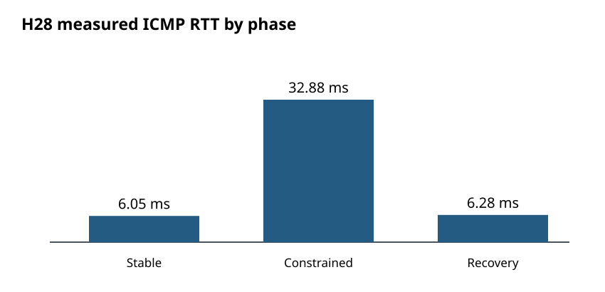
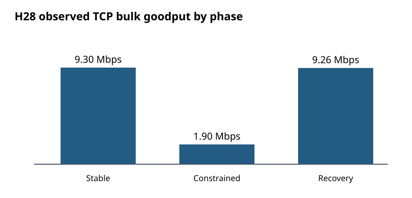

# Realistic Dynamic SDN Traffic Generation and Dataset Construction: A Scoped Experimental Evaluation

**Status:** Completed technical experimental report with declared limitations. Independent malicious attack labels remain unverified.

## Abstract

We developed and experimentally evaluated a dynamic software-defined networking (SDN) traffic-generation and dataset-construction workflow using Mininet, Ryu and OpenFlow. The campaign includes original synthetic traffic experiments, controlled replicated runs, a frozen-model prospective evaluation, and phase-specific network-fidelity measurements. We report reproducible changes in observed RTT and TCP bulk goodput under stable, constrained, and recovery configurations. The machine-learning target is synthetic probe activity, not independently verified malicious intrusion. Independent human ground-truth adjudication and emerging-attack generalization remain unestablished.

## Experimental methodology

The experimental infrastructure evaluated line and star topologies with stable, constrained, and recovery traffic-shaping phases. The H14 interval dataset was split by run ID into training, validation and held-out historical-test subsets. H22B models were selected on validation only and serialized. H23 prospectively tested the frozen candidates on different seeds without model retraining or reselection. H25 produced a smaller traffic-evidence pilot, H27 reconciled pilot measurements, and H28 repeated network-fidelity observations with two new seeds and two topologies.

H14 synthetic-probe interval dataset: **216 rows**. Split run IDs do not overlap. H23 prospective evaluation: **16 runs and 144 intervals**. H28 replication: **12 runs and 36 phase conditions**.

## Table 1. Prospective frozen-model performance (H23)

| Model | Balanced accuracy | Recall | False positive rate |
|---|---:|---:|---:|
| logistic_regression | 0.6250 | 0.5833 | 0.3333 |
| random_forest | 0.8875 | 0.8750 | 0.1000 |
| rbf_svm | 0.5000 | 0.0000 | 0.0000 |
| gradient_boosting | 0.8958 | 0.7917 | 0.0000 |
| soft_voting_ensemble | 0.8750 | 0.7500 | 0.0000 |

H23 evaluated frozen candidates against **synthetic probing labels**. Intervals within a run are correlated, so these values should not be interpreted as statistically independent samples.

## Table 2. Network fidelity replication (H28)

| Phase | Conditions | Mean RTT (ms) | ICMP loss (%) | TCP bulk goodput (Mbps) |
|---|---:|---:|---:|---:|
| stable | 12 | 6.0508 | 0.00 | 9.2999 |
| constrained | 12 | 32.8780 | 0.00 | 1.9001 |
| recovery | 12 | 6.2758 | 0.00 | 9.2628 |

Configured rate/latency settings and `tc` runtime logs were audited in H28. Observed TCP application goodput is not the same as independently calibrated link capacity. Twenty ICMP probes per condition are not sufficient to establish a precise 1% loss rate.

## Ground-truth readiness and claims

H25 technical evidence and SHA-256 inventory were checked. **12 of 12 independent reviewer records lack required fields.** No reviewer identities, authorizations, attack labels or actual service-exhaustion effects were manufactured by the finalization workflow.

### Supported conclusions

- A controlled dynamic SDN traffic-generation and dataset-construction workflow was implemented and evaluated in the tested laboratory scope.
- Run-disjoint synthetic-probe dataset splits and frozen prospective model comparisons are documented.
- H28 recorded repeatable increases in RTT and decreases in TCP bulk goodput during the constrained network phase, followed by recovery.

### Conclusions NOT established by the available evidence

- Independent malicious cyberattack ground truth, including attack intent and authorization, is not yet verified.
- The application request-burst scenario alone does not prove service exhaustion or maliciousness.
- Unseen synthetic-workload seeds do not demonstrate emerging or unseen malicious attack-family detection.
- Network phase validation does not guarantee precise loss fidelity or generalization to production networks.

## Limitations and future work

Human adjudication of H26 records, externally supported attack-family definitions, service-impact instrumentation and independent unseen-family evaluation would be required before making attack-detection claims. The existing study can be reported as a scoped dynamic SDN dataset and instrumentation framework, with the attack-detection objective explicitly limited.

## Reproducibility

- H14 dataset SHA-256: `a8027965eb8df973ddbdf8ed8eec375eb6965f408220c3c754e1a625919d6c7c`
- H22B frozen model SHA-256: `24e9cd2ddab2746f46d0429e8659641772e790d2c43378297ef441d7138dff2d`
- H22B selected candidate (validation only): `NOT_RECORDED_IN_REPORT`
- Complete source paths and source-manifest states: `01_DATASET_AND_MODEL_FREEZE/SOURCE_EVIDENCE_INVENTORY.csv`.
- This report never retrains models, runs Mininet, modifies evidence, or assigns human attack labels.
